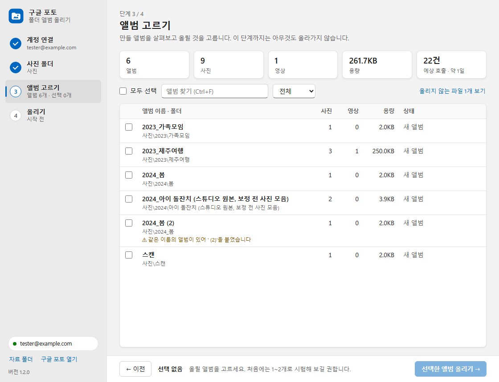
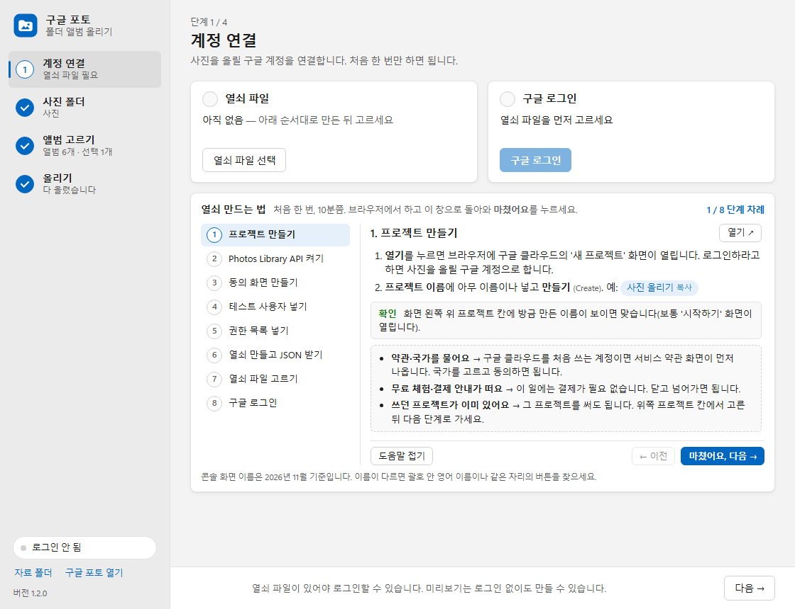

# 구글 포토 폴더 앨범 올리기

PC의 사진 폴더를 구글 포토에 **폴더마다 앨범 하나씩** 올리는 윈도우 프로그램입니다.
앨범 이름은 최상위 폴더 기준 상대 경로를 `_`로 이은 것입니다.

예: `D:\사진\2023\제주여행\*.jpg` → 앨범 `2023_제주여행`



## 할 수 있는 것

- 왼쪽 4단계(계정 연결 → 사진 폴더 → 앨범 고르기 → 올리기)로 나눠 창 한 화면에서 진행, 단계마다 상태 표시
- 올리기 전 미리보기: 만들 앨범, 장수, 용량, 올리지 않는 파일, 예상 호출 수. 앨범 이름·상태로 거르기
- 앨범을 골라 올리기, 진행 상황과 실패 목록, 끊겨도 이어 올리기
- 하루 호출 한도에 걸리면 기다렸다가 이어 감, 50MB 넘는 영상은 이어 올리기(resumable) 방식
- 확장자 없는 사진은 머리 바이트로 형식을 알아내 올림, 업로드 형식(MIME)은 파일 내용 기준

## 알아둘 제약 (구글 포토 Library API, 2025-03-31 변경 이후)

- 이 프로그램이 만든 앨범에만 넣을 수 있습니다. 앱에서 손으로 만든 기존 앨범에는 못 넣습니다.
- 원본 화질로 올라가 구글 저장 공간을 씁니다.
- API로는 올린 사진·앨범을 지울 수 없습니다. 처음에는 앨범 1~2개로 시험하세요.
- 프로젝트당 하루 10,000 요청(업로드 포함)이라 하루 약 8,000~9,800장이 올라갑니다.
- 촬영 날짜(EXIF)가 없는 사진은 타임라인에서 올린 날로 보일 수 있습니다.

## 설치 (Windows 11, Python 3.12)

```powershell
pwsh -File install.ps1                        # 모든 계정용: C:\Program Files\GPhotoAlbums, 공용 바탕화면·시작 메뉴 (관리자)
pwsh -File install.ps1 -Scope CurrentUser     # 이 계정만: %LOCALAPPDATA%\Programs\GPhotoAlbums
```

창은 WebView2 런타임(윈도우 11 기본 포함)으로 띄웁니다. 창이 뜨지 않으면 기본 브라우저로 엽니다.
제거는 설치 폴더의 `uninstall.ps1`입니다(구글 포토에 올린 것은 지우지 않음).

## 처음 한 번: 구글 클라우드 열쇠 만들기

프로그램 1단계 **계정 연결**에 같은 안내가 단계별로 나옵니다. 각 단계의 **열기**를 누르면 그 콘솔 화면이 열리고, 진행은 프로그램을 다시 열어도 이어집니다.
콘솔 화면 이름은 2026년 11월 기준입니다. 이름이 다르면 괄호 안 영어 이름이나 같은 자리의 버튼을 찾으세요.



| 단계 | 할 일 | 맞게 됐는지 |
|---|---|---|
| 1. 프로젝트 만들기 | [새 프로젝트](https://console.cloud.google.com/projectcreate)에서 이름(예: 사진 올리기) → **만들기**(Create) | 왼쪽 위 프로젝트 칸에 그 이름 |
| 2. API 켜기 | [Photos Library API](https://console.cloud.google.com/apis/library/photoslibrary.googleapis.com) → **사용**(Enable) | 버튼이 **관리**(Manage)로 바뀜 |
| 3. 동의 화면 | [Google 인증 플랫폼](https://console.cloud.google.com/auth/branding) → **시작하기**(Get started) → 앱 이름·사용자 지원 이메일 → 대상 **외부**(External) → 연락처 이메일 → 정책 동의 → **만들기** | 왼쪽에 브랜딩·대상·클라이언트·데이터 액세스 메뉴 |
| 4. 테스트 사용자 | [대상](https://console.cloud.google.com/auth/audience) → 테스트 사용자 **사용자 추가**(Add users) → 사진을 올릴 계정 → **저장**. 게시 상태는 **테스트** 그대로 | 목록에 그 이메일 |
| 5. 권한 목록 | [데이터 액세스](https://console.cloud.google.com/auth/scopes) → **범위 추가 또는 삭제** → **직접 범위 추가**(Manually add scopes)에 아래 4줄 → 표에 추가 → **업데이트** → **저장** | photoslibrary 범위 두 줄 |
| 6. 열쇠 만들기 | [클라이언트](https://console.cloud.google.com/auth/clients) → **클라이언트 만들기** → 유형 **데스크톱 앱**(Desktop app) → 만들기 → 뜨는 창에서 바로 **JSON 다운로드** | 다운로드 폴더에 `client_secret_….json` |
| 7. 열쇠 파일 고르기 | 프로그램의 **열쇠 파일 선택** → 받은 JSON | 열쇠 파일 칸이 '등록됨' |
| 8. 구글 로그인 | **구글 로그인** → 4단계 계정 → '확인하지 않은 앱'이면 **계속** → 권한 모두 체크 | 로그인 칸에 내 이메일 |

5단계에 붙여 넣을 범위:

```
https://www.googleapis.com/auth/photoslibrary.appendonly
https://www.googleapis.com/auth/photoslibrary.readonly.appcreateddata
openid
https://www.googleapis.com/auth/userinfo.email
```

> 6단계의 JSON(클라이언트 비밀번호)은 만들 때 한 번만 받을 수 있습니다(2025년 6월부터, [구글 도움말](https://support.google.com/cloud/answer/15549257)). 놓쳤으면 클라이언트를 하나 더 만드세요.

막히면:

- 로그인 때 '액세스 차단됨'(403 access_denied) → 4단계 테스트 사용자에 그 계정을 넣습니다.
- 열쇠 파일을 고를 때 "'웹 애플리케이션' 유형 열쇠입니다" → 6단계를 데스크톱 앱으로 다시 만듭니다.
- "'구글 포토에 사진 추가' 권한에 체크하지 않았습니다" → 다시 로그인하고 권한을 모두 체크합니다.
- 7일 뒤 다시 로그인하라고 나옴 → 테스트 상태 앱은 7일마다 다시 로그인해야 합니다(구글 정책).

열쇠 파일·로그인·올린 기록은 계정마다 `%LOCALAPPDATA%\GPhotoAlbums`에만 저장됩니다.

## 구조와 시험

- `app.pyw`: 시작 파일
- `gphoto/`: 폴더 훑기와 앨범 이름 규칙, 업로드 엔진, 구글 로그인, 화면용 127.0.0.1 서버
- `ui/`: 화면(HTML·CSS·JS)
- `tests/`: 가짜 구글 포토 서버로 업로드 엔진 시험, Playwright로 실제 화면 시험

```powershell
python -m venv .venv
.venv\Scripts\pip install -r requirements.txt playwright==1.60.0
.venv\Scripts\python -m unittest discover -s tests
```
